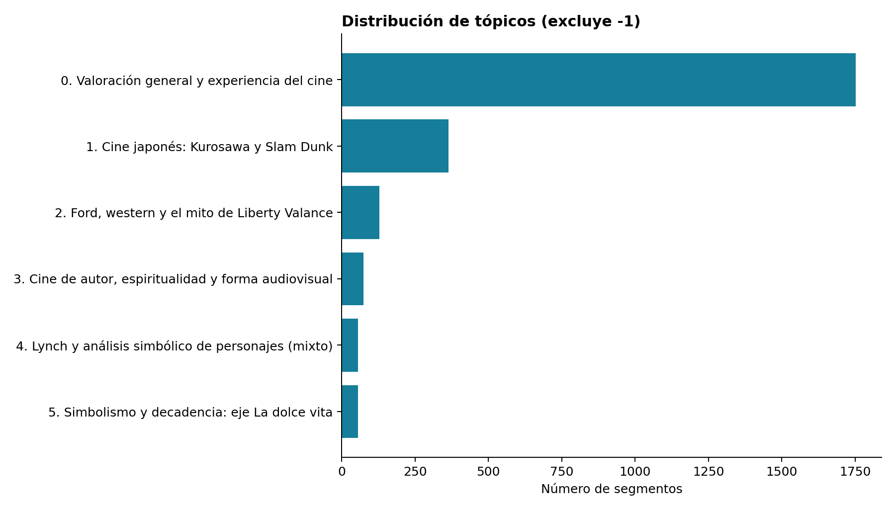

<div align="center">

# ¿De qué hablan las reseñas de Letterboxd?

**Modelado de tópicos en español con BERTopic**

Reseñas reales, dos configuraciones y un análisis reproducible de los temas que emergen al hablar de cine.

[Leer el reporte](output/pdf/reporte_letterboxd.pdf) · [Explorar los tópicos](results/catalogue_B.md) · [Reproducir el análisis](#reproducir-el-análisis)

**1,137 reseñas · 3,235 segmentos · 241 películas**

</div>

---

## El proyecto

¿Qué temas aparecen en las reseñas en español de una muestra de películas muy valoradas? Este proyecto compara dos configuraciones de BERTopic y examina cómo cambian los grupos al exigir mayor tamaño y densidad.

El PDF, las tablas y las asignaciones proceden de la misma ejecución con datos públicos reales. Los nombres de los tópicos y su interpretación se elaboraron con asistencia de IA; los resultados numéricos no son simulados.

## Resultados de un vistazo

| Medida | A · Exploratoria | B · Grupos mayores |
| :--- | ---: | ---: |
| Tópicos, sin outliers | 52 | 6 |
| Segmentos sin grupo (−1) | 1,530 | 803 |
| Outliers | 47.30% | 24.82% |
| Silhouette coseno | 0.055 | 0.012 |
| Diversidad de términos top-10 | 0.846 | 0.750 |

La configuración **B** se desarrolla en el reporte. Estas métricas describen compromisos entre cobertura y granularidad; no demuestran exactitud temática ni superioridad general. Los outliers se conservan y no se fuerzan a un tópico.



## Explorar la entrega

| Recurso | Contenido |
| :--- | :--- |
| [Reporte en PDF](output/pdf/reporte_letterboxd.pdf) | Metodología, comparación, figuras, ejemplos y conclusiones en español |
| [Catálogo A](results/catalogue_A.md) / [Catálogo B](results/catalogue_B.md) | Los 58 tópicos con nombres y ejemplos completos |
| [Tabla A](results/topic_info_named_A.csv) / [Tabla B](results/topic_info_named_B.csv) | Resumen de tópicos con nombres interpretativos |
| [Métricas](results/metrics.json) | Resultados numéricos de ambas configuraciones |
| [Código fuente](src/) | Adquisición, segmentación, modelado y construcción del reporte |
| [Paquete de entrega](output/entrega_letterboxd_bertopic.zip) | Archivos del análisis y reporte para consulta local |

Las visualizaciones interactivas de `results/*.html` se pueden descargar y abrir en el navegador sin conexión.

## Cómo funciona

**Reseñas → detección de español → segmentos → embeddings → UMAP → HDBSCAN → c-TF-IDF**

- **Corpus:** español detectado automáticamente, sin traducir reseñas; mínimo de 20 palabras por reseña.
- **Segmentación:** ventanas de 80 palabras sin solapamiento. Una cola de menos de 20 palabras se une a la ventana anterior.
- **Muestreo:** hasta 3,000 ventanas; las que exceden el límite del tokenizer se subdividen hasta obtener los 3,235 segmentos finales.
- **Encoder:** `sentence-transformers/paraphrase-multilingual-MiniLM-L12-v2`, con embeddings normalizados de 384 dimensiones.
- **Comparación:** ambas configuraciones usan exactamente los mismos segmentos y embeddings. Cambian los parámetros de HDBSCAN y los n-gramas del vectorizador.

Las frecuencias describen fragmentos de esta muestra, no porcentajes de usuarios ni de toda Letterboxd. Las probabilidades de HDBSCAN no se interpretan como probabilidades de verdad temática.

## Reproducir el análisis

Ejecución original: **Python 3.13 · Windows · CPU**. Las dependencias directas están en [requirements.txt](requirements.txt). El [registro de versiones](requirements-lock.txt) incluye paquetes heredados del entorno original y sirve como referencia, no como instalación portable.

```powershell
git clone https://github.com/ErikJajan/BERTopic.git
cd BERTopic
python -m venv .venv
./.venv/Scripts/python.exe -m pip install -r requirements.txt
./.venv/Scripts/python.exe src/prepare.py
./.venv/Scripts/python.exe src/model.py
./.venv/Scripts/python.exe src/catalogue.py
./.venv/Scripts/python.exe src/report.py
./.venv/Scripts/python.exe src/verify.py
```

La primera ejecución requiere Internet para descargar el corpus, el encoder y las stopwords. `prepare.py` descarga el CSV si falta; `model.py` usa `models/encoder` si existe o descarga la revisión registrada en `data/embedding_metadata.json`.

Se usa la semilla **42** para idioma, muestreo y UMAP; UMAP ejecuta un solo hilo. La reproducibilidad exacta se limita a versiones y plataformas equivalentes.

<details>
<summary><strong>Estructura y trazabilidad</strong></summary>

```text
BERTopic/
├── src/                  # Preparación, modelado, catálogos, reporte y verificación
├── data/                 # Segmentos y metadatos de adquisición
├── results/              # Asignaciones, métricas, tópicos y visualizaciones
├── output/
│   ├── pdf/              # Reporte final
│   └── entrega_*.zip     # Paquete de entrega
├── requirements.txt      # Dependencias directas
└── requirements-lock.txt # Registro del entorno original
```

- `data/segments.csv`: ventanas antes de ajustar el límite del tokenizer.
- `results/model_segments.csv`: segmentos efectivamente modelados.
- `results/segmentation.json`: embudo de selección y estadísticas.
- `results/topic_info_A.csv` y `topic_info_B.csv`: salida de `get_topic_info`.
- `results/assignments_A.csv` y `assignments_B.csv`: asignación por segmento.
- `results/representatives_A.json` y `representatives_B.json`: tres ejemplos por tópico.
- `results/interpretation.json`: interpretación cualitativa de B.

</details>

## Fuente y alcance

Riyosha, [*Letterboxd Movie Reviews (~90,000)*](https://www.kaggle.com/datasets/riyosha/letterboxd-movie-reviews-90000), versión 1, actualizado el **5 de septiembre de 2024**.

Los metadatos de Kaggle declaran CC0; esta declaración del publicador no verifica la titularidad de cada reseña. El corpus se utiliza para análisis académico y se conserva la atribución al dataset. El archivo original no proporciona autor ni URL individual de las reseñas; los identificadores `Rxxxxx` corresponden a su posición en el registro original. El archivo bruto está excluido del seguimiento de Git.

La muestra favorece películas muy valoradas y reseñas disponibles en la captura de 2024. La detección automática del idioma y la segmentación tienen limitaciones que se detallan en el reporte. La imagen del enunciado alojada en Canvas no fue accesible; se aplicó el criterio explícito y reproducible descrito aquí.

## Uso de IA

La IA asistente apoyó la programación, la interpretación y los nombres de tópicos. No se ejecutó el bonus de comparación con un LLM por API ni se contrataron tokens para ese experimento. La asistencia se declara en el PDF y no constituye validación humana independiente.
